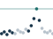

% The site's home page. README.md is the GitHub front page; this page opens with the same
% hero banner as the Resources site and the AD Loci Explorer, then the start cards,
% which GitHub cannot render.

<div class="fx-hero">


<div class="fx-hero__text">
<p class="fx-hero__org">ADSP Functional Genomics Consortium (FunGen-AD)</p>
<h1 class="fx-hero__title">FunGen<span class="fx-hero__x">-xQTL</span> Protocol</h1>
<p class="fx-hero__lead">Reproducible, reusable pipelines for molecular QTL (xQTL) analysis, from reference data and molecular phenotypes to association scans, fine-mapping, colocalization and TWAS. A molecular QTL is a genetic variant linked to a change in a molecular trait, such as gene expression, splicing, protein level or DNA methylation.</p>
<p class="fx-hero__btns"><a class="fx-pill fx-pill--solid" href="https://statfungen.github.io/xqtl-protocol/xqtl-protocol-workflow-builder/">Build an analysis workflow</a><a class="fx-pill" href="https://statfungen.github.io/xqtl-protocol/xqtl-protocol-demo/">Set up the software</a></p>
</div>
</div>

## Where do you want to start?

::::{grid} 1 2 2 2
:class: fx-start

:::{card} Build an analysis workflow
:link: ../website/_generated/xqtl_protocol_workflow_builder.ipynb
Try a tested example, or describe your study. Get the modules to run, in order, the files each one needs, and one script for a local computer, SLURM or SGE.
:::

:::{card} Browse methods and modules
:link: methods_and_references.md
Every method the protocol runs, by analysis stage, with its module page and the paper to cite.
:::
::::

New here? Install the software first with [Environment setup](../code/SoS/xqtl_protocol_demo.ipynb).

```{include} ../README.md
:start-after: <!-- site-home-continues -->
:end-before: ## Overview of the protocol
```

:::::{dropdown} Overview of the protocol
```{include} ../README.md
:start-after: <!-- site-overview -->
:end-before: <!-- site-overview-end -->
```
:::::

:::::{dropdown} How to use the resource
```{include} ../README.md
:start-after: <!-- site-use -->
:end-before: <!-- site-use-end -->
```
:::::

```{include} ../README.md
:start-after: <!-- site-use-end -->
```
